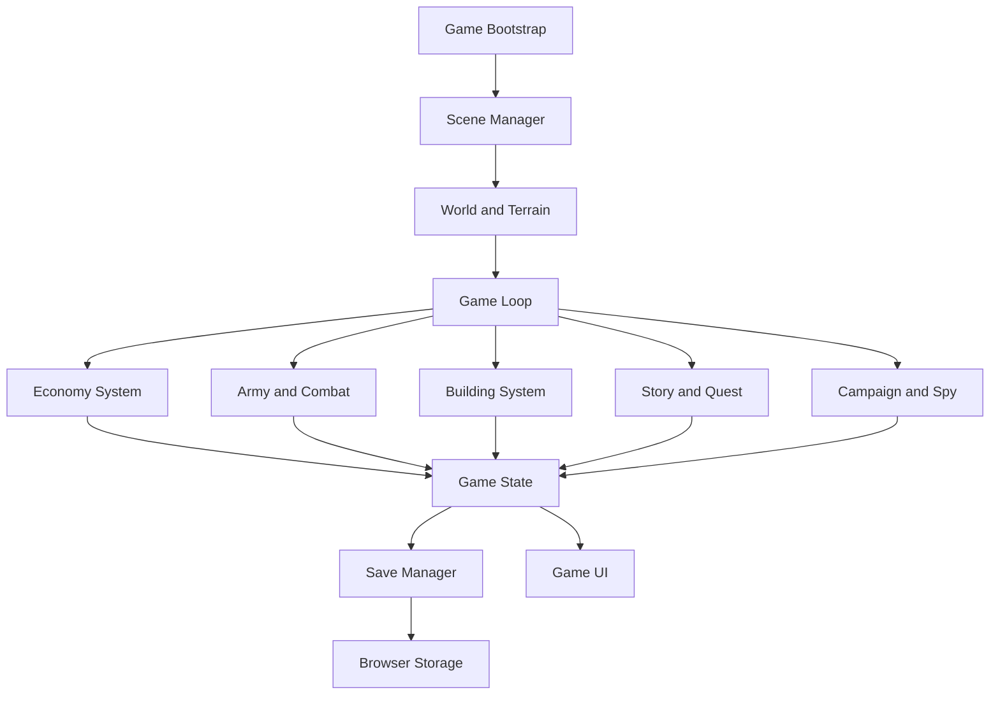

# Gölgedeki Miras

A low-poly 3D medieval kingdom strategy game built with Three.js, Vite and a gradually modularized TypeScript simulation layer.

## Current playable prototype

- Isometric low-poly castle scene and responsive HUD
- Touch/mouse camera interaction, zoom and keyboard movement
- Selectable structures and units
- Farms, lumber camps, quarries and markets
- Militia training and day-based resource production

## TypeScript game architecture

The TypeScript entrypoint (src/main.ts) starts the existing Three.js presentation layer and initializes the modular game domain. The current visual prototype is preserved while simulation logic is moved into independent modules.

- **Core:** bootstrap, event bus, fixed-step loop, scene manager and versioned local save
- **World/camera:** terrain, environment, region registry and isometric camera helpers
- **Systems:** economy, construction costs, army recruitment, battle resolution, campaign regions, scouting, council decisions, loyalty and quest evaluation
- **Entities:** soldier, commander, enemy, villager and building primitives
- **Story:** dialogue history, player-choice memory and ending evaluation
- **Data/UI:** typed balance catalogs and UI module directories ready for dedicated panels
- **Persistence:** IndexedDB save slots with a localStorage fallback and basic payload/version validation

The domain game instance is exposed as window.__SHADOW_LEGACY__.game for development inspection. Call game.advanceDay() to run the typed economy, loyalty and quest simulation; call game.save() to persist the state.

## Run locally

```bash
npm install
npm run dev
```

## Build and tests

```bash
npm run build
npm test
npm run test:watch
npm run test:e2e
```

Unit tests cover economy, combat, save/load and campaign rules. The Playwright mobile smoke test is configured separately and requires the Playwright browser to be installed.

## Controls

- Drag: rotate the existing game camera
- Mouse wheel or +/- buttons: zoom
- WASD / arrow keys: move the view
- Choose a building, then tap/click an open area to place it
- Advance day to collect production
- Train militia to grow the army

## Deployment

Vercel uses the Vite build and publishes the dist directory. Run npm run build before considering a deployment verified.

## License

MIT. Third-party assets added later must retain their own licenses.

## Runtime flow


